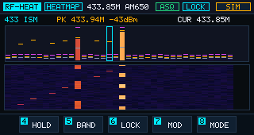

# RF Heatmap for CardputerZero

A fast, user-friendly **CC1101 Sub-GHz Thermal Waterfall, RSSI Oscilloscope, OOK Protocol Decoder & Flipper `.sub` Studio** with **on-device Smart Squelch & Auto-Lock ML** for the **M5Stack CardputerZero** + **Cap CC1101**.



## Features

- **HEATMAP (Spectrum + Thermal Waterfall)**: Sweep `433 ISM`, `868 EU`, `315 US`, `915 ISM`, or `ALL ISM` (`300–928 MHz`) with live RSSI bars, amber Peak-Hold markers, per-bin ML noise floor / Smart Squelch ticks, and a scrolling Inferno thermal waterfall (`-110 dBm` to `-35 dBm`). Press `Enter` or `6 (LOCK)` to jump straight to the strongest frequency.
- **On-Device ML — Smart Squelch (`S`) & Auto-Lock (`L`)**: Zero-allocation per-bin EWMA baseline (`internal/rfml/baseline.go`) with Welford warmup, burst-freeze guard (`z ≥ 3.0`), adaptive threshold (`μ + k·σ`, tunable with `F/X` in `PULSE`), and automatic cursor lock onto `z ≥ 4.0` bursts.
- **PULSE (RSSI Scope & RAW Capture)**: Real-time dBm meter, live Z-score badge, Smart Squelch `k` tuning or manual dBm squelch (`F/X`), fine frequency tuning (`Z/C`), `AM650`/`AM270`/`FM238`/`FM476` presets, and Flipper `.sub` RAW save/replay.
- **DECODE (Live OOK Analyzer + 1D K-Means Denoiser)**: Auto-decodes `Princeton`, `CAME`, and `Linear` OOK frames, showing protocol, bit length, hex key, and base pulse width `TE (µs)`. Automatically merges EMI glitches (`< 60 µs`) and runs deterministic **1D K-Means** pulse quantization (`ML-CLEAN`) to rescue weak or jittery captures.
- **SAVED (`.sub` Library)**: Browse, load, delete, and transmit Flipper-compatible `.sub` files from `~/rf-heatmap/captures/` and `~/subg/files/`.
- **SET (Settings & Opt-In MCP Server)**: Configure Smart Squelch (`k`), Auto-Lock, and explicitly toggle the built-in pure-Go **MCP Server** (`mcp_enabled`, disabled by default, saved in `~/.config/rf-heatmap/config.json`).
- **Built-in 4-Page Help (`H`)**: Interactive manual right on the device.
- **Zero Dependencies**: Pure Go (`CGO_ENABLED=0`), renders directly to `/dev/fb0` (320×170 RGB565) and reads `/dev/input/event*` without X11/Wayland or root privileges.

## Controls

| Key | Action |
| --- | --- |
| `4`–`8` | Bottom navigation bar actions |
| `Tab` / `8` | Switch mode (`HEATMAP → PULSE → DECODE → SAVED`) |
| `F` / `X` (`↑` / `↓`) | Up / Down (band, Smart Squelch `k` / manual squelch in `PULSE`, list selection) |
| `Z` / `C` (`←` / `→`) | Left / Right (cursor channel, `±50 kHz` frequency step) |
| `B` / `M` | Cycle ISM band / modulation preset |
| `S` / `L` | Toggle **Auto Squelch (`ASQ`)** / **Auto-Lock (`LOCK`)** |
| `Enter` | Lock peak frequency / transmit |
| `H` | Open 4-page interactive Help |
| `Q` / `Esc` | Quit safely (restores `GPIO 14` & puts CC1101 in `IDLE`) |

## Documentation

- **Interactive Learning Portal**: [`../learning-portal/`](../learning-portal/) — full English guides for RF Heatmap, Sub-GHz & CC1101 theory, Smart Squelch ML, and interactive browser labs.
- **Detailed App Guide**: [`docs/GUIDE.md`](docs/GUIDE.md) — in-depth device walkthrough and reference.

## Build & Package (`.deb`)

```bash
go test -race ./...
./scripts/build_deb.sh
```

This produces `dist/rf-heatmap_0.1.0-1_arm64.deb` ready for installation (`sudo dpkg -i`) or publishing via `czdev publish --deb dist/rf-heatmap_0.1.0-1_arm64.deb`.

## Built-In MCP Server (SSH Opt-In)

After enabling **MCP Server (SSH)** in the **`SET`** tab (`~/.config/rf-heatmap/config.json` -> `"mcp_enabled": true`), AI agents can invoke `rf-heatmap` over SSH stdio:

```bash
ssh <cardputer-host> /usr/share/APPLaunch/bin/rf-heatmap --mcp
```

Exposed tools: `rf_get_status`, `rf_sweep_band`, `rf_read_rssi`, `rf_decode_ook`, `rf_analyze_pulses`, `rf_classify_signal`, `rf_match_fingerprint`, `rf_foxhunt_track`, `rf_list_saved`, `rf_read_saved`, `rf_save_capture`, `rf_delete_saved` (`confirm: true`), `rf_purge_noise` (`dry_run: true` by default; deletion requires `dry_run: false, confirm: true`).

## License

MIT — see [LICENSE](LICENSE).
