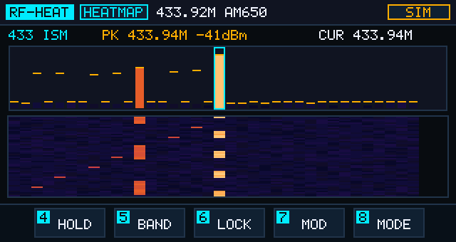
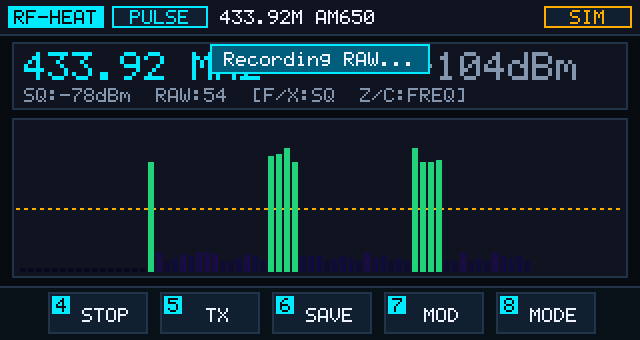
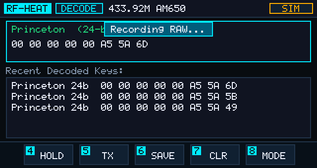
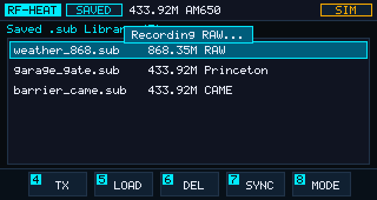
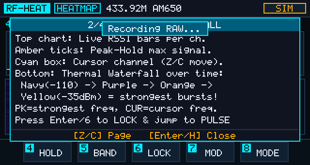

# RF Heatmap — Подробное руководство по Sub-GHz и работе с CC1101 на CardputerZero

> **Важно (безопасность и закон):** Используйте сканирование и особенно передачу (`TX`) **только** для анализа собственных устройств, стендов, датчиков и разрешённых ISM-диапазонов вашего региона. Не подключайте и не отключайте модуль **Cap CC1101** «на горячую» — всегда выключайте CardputerZero перед снятием/установкой модуля.

---

## 1. Основы Sub-GHz: что мы вообще слушаем?

Диапазон **Sub-GHz** (ниже 1 ГГц, обычно **300–928 МГц**) используют тысячи бытовых и промышленных беспроводных устройств, потому что низкие частоты лучше проходят сквозь стены и тратят меньше энергии, чем Wi-Fi/Bluetooth (2.4 ГГц).

Чип **TI CC1101** на модуле **Cap CC1101** — это программируемый узкополосный трансивер. Он не «видит» весь эфир сразу, как дорогой SDR, но умеет **очень быстро перепрыгивать с частоты на частоту**, измерять силу сигнала (**RSSI** в `dBm`), демодулировать **AM/OOK** и **2-FSK** сигналы и передавать их обратно.

### Какие частоты для чего используются

| Диапазон | Регион | Что там обычно работает | Особенности |
| --- | --- | --- | --- |
| **315 МГц** (`315 US`) | США, Азия, часть авто | Автобрелоки (старые/американские), датчики давления в шинах (**TPMS**), гаражные ворота | В Европе/РФ часто запрещён для TX |
| **433.92 МГц** (`433 ISM`) | Весь мир (основной!) | Шлагбаумы (`CAME`, `Nice`), звонки, беспроводные розетки (`Princeton`), метеостанции, сигнализации | Самый «шумный» и популярный диапазон; полоса `433.05–434.79 МГц` |
| **868.35 МГц** (`868 EU`) | Европа, РФ | Умный дом, датчики протечки/дыма, **LoRa EU868**, промышленная телеметрия, современные автобрелоки | Эфир чище, чем на 433; выше дальность и меньше помех |
| **915 МГц** (`915 ISM`) | Америка, Австралия | **LoRa US915**, Meshtastic, промышленные датчики, RFID/телеметрия | В ЕС/РФ пересекается с сотовыми сетями (GSM-900) — не передавать! |

> **Совет:** Если не знаете, на какой частоте работает устройство — начните с режима **`ALL ISM`** (клавиша **`B`**), он пройдёт по 24 ключевым точкам от 300 до 925 МГц, а затем переключитесь на конкретный диапазон (`433 ISM` или `868 EU`) для детального просмотра.

---

## 2. Интерфейс и управление

Экран CardputerZero (`320×170`) разделён на три зоны:
1. **Верхняя шапка**:
   - `RF-HEAT` — логотип приложения.
   - `HEATMAP / PULSE / DECODE / SAVED` — текущий режим.
   - `433.92M AM650` — активная частота и выбранная модуляция.
   - Справа: **`CC1101`** (зелёный — реальный чип найден по SPI) или **`SIM`** (янтарный — запущен режим симулятора, если Cap не подключён).
2. **Рабочая область** — график, тепловая карта, осциллограф или список файлов.
3. **Нижняя панель (`4` `5` `6` `7` `8`)** — выровнена ровно над физическими клавишами `4`–`8` на клавиатуре CardputerZero.

### Горячие клавиши

| Клавиша | Действие |
| --- | --- |
| **`4` `5` `6` `7` `8`** | Быстрые действия нижней панели (меняются в каждом режиме) |
| **`Tab`** или **`8`** | Переключение между 4 режимами (`HEATMAP → PULSE → DECODE → SAVED`) |
| **`F` / `X`** (или `↑` / `↓`) | Вверх / Вниз (смена диапазона, порога Squelch, выбор файла) |
| **`Z` / `C`** (или `←` / `→`) | Влево / Вправо (движение курсора по частотам, подстройка частоты) |
| **`B`** | Переключение ISM-диапазона (`433 ISM` → `868 EU` → `315 US` → `915 ISM` → `ALL ISM`) |
| **`M`** | Переключение модуляции (`AM650` → `AM270` → `FM238` → `FM476`) |
| **`Enter`** | В `HEATMAP`: зафиксировать пик и перейти в `PULSE`; в `PULSE`/`DECODE`/`SAVED`: передача (`TX`) |
| **`H`** | Открыть/закрыть встроенный 4-страничный Help |
| **`Q`** или **`Esc`** | Безопасный выход (переводит CC1101 в `IDLE` и возвращает `GPIO 14` в исходное состояние) |

---

## 3. Как читать каждый экран

### Режим 1: `HEATMAP` — Спектр + Тепловая карта (Waterfall)

Это ваш главный радар для поиска активности в эфире.

#### Как читать верхнюю гистограмму:
- **Столбики (Bars)** — мгновенная сила сигнала **RSSI** в каждом канале выбранного диапазона. Чем выше столбик, тем мощнее передатчик (в `dBm`).
- **Янтарные чёрточки над столбиками (Peak-Hold)** — «память пиков». Если вы нажали кнопку на брелоке на доли секунды, столбик сразу упадёт, а **янтарная метка останется висеть** на максимальном уровне — вы сразу увидите, на какой именно частоте сработал пульт. *(Сбросить пики: клавиша `X` / `↓`.)*
- **Голубая рамка (Cursor)** — выбранный вручную канал (двигается клавишами `Z` / `C`). Его точная частота написана справа сверху: `CUR 433.94M`.
- **`PK 433.94M -41dBm`** — самая мощная частота за текущую сессию и её максимальный уровень.

#### Как читать нижнюю тепловую карту (Waterfall):
Тепловая карта показывает **историю эфира во времени** (новые строки появляются сверху и сдвигаются вниз, как водопад):
- **Тёмно-синий / чёрный (`-110..-95 dBm`)** — тишина (фоновый шум).
- **Фиолетовый / малиновый (`-90..-70 dBm`)** — слабый или далёкий сигнал (датчик за стеной, соседний брелок).
- **Оранжевый (`-65..-50 dBm`)** — уверенный сигнал поблизости.
- **Ярко-жёлтый / белый (`-45..-35 dBm`)** — очень мощный передатчик прямо рядом с антенной.

#### Что можно понять по «рисунку» на тепловой карте:
- **Редкие короткие яркие полоски на одной вертикали** — нажатия кнопок пульта/брелока или периодические посылки метеостанции (раз в 30–60 секунд).
- **Сплошная яркая вертикальная полоса** — постоянно работающий передатчик (например, аудионяня, радиомикрофон или «залипшая» кнопка/помеха).
- **Яркие точки, «прыгающие» по разным столбцам** — устройство с псевдослучайной перестройкой частоты (**FHSS**, например LoRa/современные охранные системы).

#### Когда что жать в `HEATMAP`:
- Нажмите кнопку тестируемого пульта → увидите яркий след на карте и янтарный пик → нажмите **`Enter`** (или **`6 LOCK`**), чтобы моментально зафиксировать пиковую частоту и перейти в режим **`PULSE`**.
- Нажмите **`4 HOLD`** (`Space`), чтобы поставить водопад на паузу и спокойно рассмотреть след.
- Нажмите **`5 BAND`** (`B`), чтобы сменить диапазон.

---

### Режим 2: `PULSE` — Осциллограф RSSI и запись RAW

Здесь вы стоите на **одной конкретной частоте** и видите каждый импульс в реальном времени.

#### Что означают показатели:
- **Крупная цифра слева (`433.92 MHz`)** — текущая частота. Можно подстраивать с шагом `50 кГц` клавишами **`Z / C`**.
- **Крупная цифра справа (`-54 dBm`)** — текущий уровень сигнала.
  - `-105..-90 dBm`: чистый шумовой порог.
  - `-75..-60 dBm`: нормальный сигнал на расстоянии нескольких метров.
  - `-50..-30 dBm`: сигнал вплотную к антенне.
- **`SQ:-78dBm` (янтарная пунктирная линия на графике)** — **Squelch (порог шумоподавления)**. Всё, что ниже линии — считается шумом (рисуется тепловым цветом); всё, что выше — полезным сигналом (**подсвечивается зелёным**). Регулируется клавишами **`F / X`**.
- **`RAW:24`** — количество захваченных импульсов (длительностей в микросекундах `+high / -low`).

#### Какую модуляцию выбрать (`M` или `7 MOD`)?
- **`AM650`** *(OOK, полоса 650 кГц)* — **выбор по умолчанию** для 90% бытовых пультов, розеток, звонков и шлагбаумов. Широкая полоса прощает неточность кварца дешёвых брелоков.
- **`AM270`** *(OOK, полоса 270 кГц)* — то же самое, но уже полоса: меньше ловит соседние помехи, если частота известна точно.
- **`FM238`** *(2-FSK, девиация 2.38 кГц)* — для устройств с частотной модуляцией (некоторые датчики, системы сигнализации, умный дом).
- **`FM476`** *(2-FSK, девиация 47.6 кГц)* — широкополосный FSK (например, некоторые TPMS, метеостанции, рации/телеметрия).

#### Когда что жать в `PULSE`:
1. Нажмите **`4 REC`** (`Space`) → нажмите кнопку на пульте → нажмите **`4 STOP`**.
2. Нажмите **`6 SAVE`**, чтобы сохранить запись в формате **Flipper SubGhz RAW (`.sub`)** в папку `~/rf-heatmap/captures/`.
3. Нажмите **`5 TX`** (`Enter`), чтобы воспроизвести записанный сигнал.

---

### Режим 3: `DECODE` — Живой анализатор OOK-протоколов

В отличие от `RAW` (слепой записи импульсов), `DECODE` пытается **распознать смысл посылки** и извлечь цифровой ключ.

#### Что показывает экран:
- **Protocol**: название протокола (`Princeton`, `CAME`, `Linear`).
- **Bits**: разрядность ключа (`24-bit`, `12-bit`, `10-bit`).
- **TE (`µs`)**: *Time Element* — базовая длительность одного короткого импульса в микросекундах (например, `TE = 350us` означает, что бит `0` — это `350 мкс` несущей и `1050 мкс` паузы, а бит `1` — `1050 мкс` несущей и `350 мкс` паузы).
- **Hex Key** (`00 00 00 00 00 A5 5A 01`): расшифрованный уникальный код кнопки.
- **Recent Decoded Keys**: журнал последних 6 принятых посылок.

> **Почему некоторые пульты не декодируются в `DECODE`?**
> 1. Они используют **динамический (rolling) код** (например, `KeeLoq`, автомобильные брелоки) — каждый раз передаётся новый зашифрованный пакет. Такие сигналы нужно смотреть в `HEATMAP`/`PULSE`, но простое воспроизведение (`replay`) на нормальных системах не сработает (и это нормально с точки зрения безопасности).
> 2. Они используют **2-FSK** (`FM238`/`FM476`) или нестандартный тайминг — тогда их можно записать через `PULSE` → `REC` в формате `RAW`.

---

### Режим 4: `SAVED` — Библиотека `.sub`-файлов

Просматривает все файлы `.sub` в `~/rf-heatmap/captures/` и `~/subg/files/` (полная совместимость с **Flipper Zero** и **ZeroSub**!).

- **`F / X`** — выбор файла в списке.
- **`4 TX`** (`Enter`) — передать выбранный файл.
- **`5 LOAD`** — загрузить частоту файла и открыть его в режиме `PULSE`.
- **`6 DEL`** (`Backspace`/`Delete`) — удалить файл.
- **`7 SYNC`** — пересканировать папки на диске.

---

### Встроенная справка (`H`)

В любой момент нажмите **`H`**, чтобы открыть встроенный 4-страничный справочник прямо на экране CardputerZero. Страницы листаются **`Z / C`**.

---

## 4. Типовой сценарий: «Найти и изучить неизвестный пульт за 15 секунд»

1. Запустите **RF Heatmap** из меню CardputerZero.
2. Нажмите **`B`**, выберите диапазон (обычно **`433 ISM`** или **`868 EU`**).
3. Поднесите пульт к антенне на 10–30 см и нажмите кнопку на пульте на 1–2 секунды.
4. Увидите яркий жёлто-оранжевый след на тепловой карте и янтарный пик на гистограмме → нажмите **`Enter`** (`LOCK`).
5. Приложение переключится в **`PULSE`** на точной частоте пульта. Подкрутите порог `SQ` (`F/X`), чтобы зелёным подсвечивался только полезный сигнал.
6. Перейдите в **`DECODE`** (`Tab`): если пульт со статическим кодом (`Princeton`/`CAME`/`Linear`), вы сразу увидите его Hex-ключ и `TE`. Нажмите **`6 SAVE`**, чтобы сохранить `.sub`-файл!
