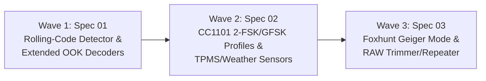

# `rf-heatmap` — RF Swiss-Army Upgrade Specifications (SDD)

This directory contains the authoritative **Spec-Driven Development (SDD)** specifications for upgrading `rf-heatmap` on M5Stack CardputerZero (`320×170` RGB565 `/dev/fb0`, 46-key TCA8418 keyboard, Cap CC1101 Sub-GHz transceiver, ARM64 `CGO_ENABLED=0`, Go `1.27+`).

All specifications strictly obey the repository's DDD contracts in [DOMAIN.md](../../DOMAIN.md) and visual/architectural rules in [DESIGN.md](../../DESIGN.md).

---

## 1. Specification Index

| # | Spec Document | User Stories | Primary Packages | New MCP Tools |
| --- | --- | --- | --- | --- |
| **01** | [01-rolling-code-and-decoders.md](01-rolling-code-and-decoders.md) | `US-RF-1.1` – `US-RF-1.4` | `internal/subfile`, `internal/ui`, `internal/mcpserver` | `rf_analyze_rolling_code` |
| **02** | [02-fsk-tpms-weather.md](02-fsk-tpms-weather.md) | `US-RF-2.1` – `US-RF-2.4` | `internal/cc1101`, `internal/sensors`, `internal/ui`, `internal/mcpserver` | `rf_decode_sensor` |
| **03** | [03-foxhunt-and-raw-trimmer.md](03-foxhunt-and-raw-trimmer.md) | `US-RF-3.1` – `US-RF-3.4` | `internal/rfml`, `internal/subfile`, `internal/library`, `internal/ui`, `internal/mcpserver` | `rf_foxhunt_sample`, `rf_trim_raw` |
| **04** | [04-freqest-txpower-and-wor.md](04-freqest-txpower-and-wor.md) | `US-RF-4.1` – `US-RF-4.3` | `internal/cc1101`, `internal/config`, `internal/ui`, `internal/mcpserver` | `rf_measure_freq_offset`, `rf_set_tx_power`, `rf_wor_listen` |
| **05** | [05-packet-engine-chat-and-pocsag-wmbus.md](05-packet-engine-chat-and-pocsag-wmbus.md) | `US-RF-5.1` – `US-RF-5.3` | `internal/cc1101`, `internal/sensors`, `internal/mcpserver` | `rf_send_packet`, `rf_recv_packet`, `rf_decode_pocsag`, `rf_decode_wmbus` |
| **06** | [06-room-baseline-emi-diff.md](06-room-baseline-emi-diff.md) | `US-RF-6.1` – `US-RF-6.3` | `internal/rfml`, `internal/ui`, `internal/mcpserver` | `rf_save_room_baseline`, `rf_list_room_baselines`, `rf_diff_room_baseline`, `rf_delete_room_baseline` |

---

## 2. Architectural & DDD Guardrails (Mandatory Across All Specs)

1. **Bounded Context Integrity**: All new logic stays inside the `rf-heatmap` bounded context. Zero imports from `nfc-studio` or `ir-studio`; zero external ML/Python/CGO runtimes.
2. **Anti-God-File Cap (`<= 350` lines/file, `<= 40` lines/function)**:
   - Decompose new decoders, sensor parsers, trimmer logic, and UI sub-views into dedicated single-responsibility files (`decoders_ext.go`, `rolling.go`, `trimmer.go`, `view_sensors.go`, `view_foxhunt.go`, `view_trimmer.go`).
   - Note: `internal/mcpserver/schema.go` is already 495 lines; register new tool schemas in a modular `internal/mcpserver/schema_ext.go` (or split `schema.go` by domain) so no modified/new file exceeds `350` lines.
3. **Domain Struct Composition**: Embed cohesive sub-structs inside `ui.App` (`RollingState`, `SensorState`, `FoxhuntViewState`, `TrimmerState`) rather than adding flat fields to `ui.App` or `PulseState`.
4. **Domain Invariants (Never Violate)**:
   - **Sign-Alternation Invariant**: `RAW_Data` pulse trains MUST strictly alternate `+high / -low` with zero `0 µs` samples.
   - **External-DB Read-Only Invariant**: Trimmed `.sub` files MUST be written atomically (`*.tmp` → `os.Rename`) strictly into `~/rf-heatmap/captures/` (`UserLibrary`); `~/rf-heatmap/databases/` and `~/subg/files/` are strictly read-only.
   - **Default-Deny MCP Invariant**: All new MCP tools inherit the `config.Settings.MCPEnabled` (`false` by default) gate and serialize radio hardware access via `Server.radioMu` / `CC1101Backend.mu`.
   - **Zero-Allocation Hot Path**: `rfml.KalmanRSSI.Update` and `rfml.FoxhuntTracker.Update` MUST run with `0 B/op, 0 allocs/op`.
   - **Antenna Band-Split & Idle-Safe Invariant**: Switching between ASK/OOK and 2-FSK/GFSK profiles MUST leave `IOCFG2`, `GPIO 14`, and `PATABLE` consistent and restore `IDLE` (`0x36`) on exit.
5. **Post-Feature Documentation Workflow (`AGENTS.md`)**:
   - Update in-app `helpPages` (`internal/ui/chrome.go`), `rf-heatmap/README.md`, `learning-portal/content/rf-heatmap/guide.md`, domain theory + interactive widgets in `learning-portal/`, and `learning-portal/content/glossary.md`.
   - Regenerate `320×170` screenshots via `go run ./cmd/shots` and copy to `learning-portal/assets/rf-heatmap/`.

---

## 3. Recommended Execution Order



- **Wave 1 (`Spec 01`)** extends `internal/subfile` and `DECODE` view with zero hardware register risk.
- **Wave 2 (`Spec 02`)** adds CC1101 2-FSK/GFSK modem presets and the pure-Go `internal/sensors` package + `SENSORS` sub-view.
- **Wave 3 (`Spec 03`)** delivers the full-screen `FOXHUNT` Geiger view and atomic `TRIM` RAW editor + repeater.

---

## 4. Verification Baseline (Required Before Marking Any Spec Done)

```bash
cd rf-heatmap
go test -race -cover ./...
go test -bench=. -benchmem ./internal/rfml/...
GOOS=linux GOARCH=arm64 CGO_ENABLED=0 go build ./cmd/rf-heatmap
```

Target: **`>= 90%` statement coverage** on all new packages/files, zero race conditions, zero fuzz panics, and `0 allocs/op` on `rfml` hot paths.
